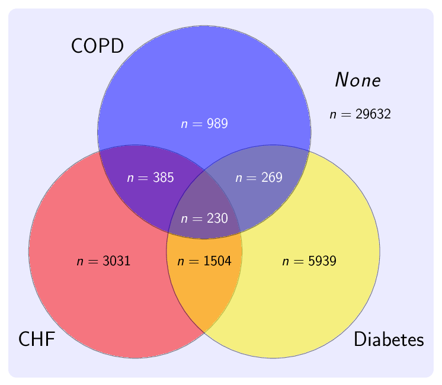
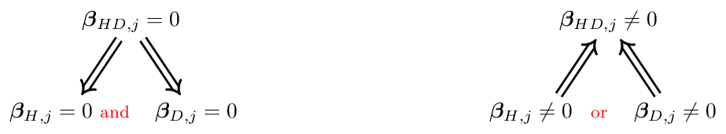
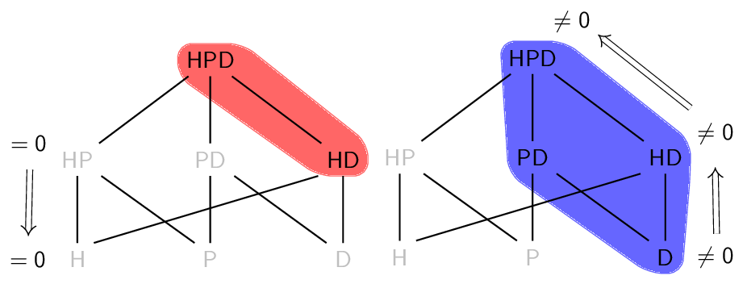

# `vennLasso` Intro 

The `vennLasso` package is an implementation of the methods proposed in @huling18 <https://doi.org/10.1111/biom.12769>. The underlying methodology is motivated by the need to address population heterogeneity in hospital system-wide risk modeling applications, however it can be used in a wide variety of settings. It is useful for high-dimensional modeling scenarios where heterogeneity is defined by several binary factors which stratify the population into multiple subpopulations. For example, `vennLasso` can be used in a hospital-wide risk modeling application if covariate effects in risk models differ for subpopulations of patients with different chronic conditions. Here the chronic conditions are the binary stratifying factors. The `vennLasso` provides computation for a variable selection method which yields variable selection patterns which adhere to the hierarchical nature of the relationships between the various subpopulations. 

If the chronic conditions congestive heart failure (CHF), chronic obstructive pulmonary disorder (COPD), and diabetes are used as the stratifying factors, the subpopulations may look like in Figure 1.


```{r fig-strata-data, echo = FALSE, out.width = "75%", fig.align = "center", fig.cap = "Figure 1: Sample sizes for each subpopulation in the motivating cohort."}

```

## Model Setup

We allow for covariate effects to vary based on a set of binary stratifying factors by positing separate (generalized) linear models for each subpopulation (defined by the presence of specific combinations of these binary factors). Denote $Y_{ik}$ as the response for patient $i$ of subpopulation $k$, $X_{ik}$ is the vector of length $p_k$ of covariate values for patient $i$ of subpopulation $k$, and $g(\cdot$ as a known link function.   Continuing the example with models stratified based on CHF, COPD, and diabetes, the posited models are the following:

$$E[ Y_{ik}|  \mathbf{X}_{ik}]  = g^{-1}(\mathbf{X}_{ik}\boldsymbol{\beta}_{k,\bullet}), i = 1, \dots, n_k$$,

where $k \in \{ H, P, D, HP, HD, PD, HPD, none \}$,

- $H$ = Congestive **Heart** Failure
- $P$ = Chronic Obstructive **Pulmonary** Disease
- $D$ = **Diabetes**
- $HP$ = C**H**F + CO**P**D
- $\dots$
- $none$ = None of $H$, $P$, or $D$,
  
  $\mathbf{X}_k$ is of dimension $n_k\times p_k$, and $\boldsymbol{\beta}_{k,\bullet}=(\beta_{k,1},\dots,\beta_{k,p})$. Note that  different covariates are allowed for different subpopulations. This can be useful if there are variables specific to particular stratifying factors, e.g. the particular location of a heart failure is only relevant for patients with any heart failures.

The `vennLasso` package provides estimation and variable selection for the parameters in these models. The variable selection is performed in a scientifically-plausible manner that adheres to the inherent relationships between the subpopulations. Furthermore, the manner in which the variable selection is performed allows for the borrowing of strength across subpopulations. 

## Borrowing Strength Across Subpopulations via Hierarchical Importance

Consider for a moment a simpler scenario where models are stratified based on only CHF and diabetes. The variable selection performed by `vennLasso` is based on an assumption of hierarchical variable selection. This assumption has two components, outlined in Figure 2 and for models with three stratifying factors in Figure 3. The first component of the hierarchical assumption is that if a particular variable is *not* important for a given subpopulation, it is not important for all 'descendent' subpopulations, i.e. subpopulations that only have any of the binary factors present in the given subpopulation. For example, the $P$ subpopulation is a descendent of the $HPD$ subpopulation. The second component is that if a particular variable is important for a given subpopulation, it should be important for all 'parent' subpopulations, i.e. any subpopulations that have at least all of the stratifying factor present in the given subpopulation. For example, the $HPD$ subpopulation is a parent of the $HP$ subpopulation.

For the $j^{th}$ variable

```{r fig-sel-patterns-one, echo = FALSE, out.width = "95%", fig.align = "center", fig.cap = "Figure 2: Hierarchical selection patterns for models with two stratifying factors."}

```


```{r fig-sel-patterns, echo = FALSE, out.width = "95%", fig.align = "center", fig.cap = "Figure 3: The two highlighted groups represent hierarchical selection patterns."}

```


## Loss Function for Hierarchical Selection

The `vennLasso` package estimates coefficients with the hierarchical variable selection patterns described above using the penalized likelihood framework:

$$
f(\boldsymbol{\beta}) = \sum_{k=1}^K\ell_k(\boldsymbol{\beta}_{k,\bullet}) - \lambda P(\boldsymbol{\beta}) \qquad (1)
$$

where $\ell_k$ are log-likelihood functions (or negative loss), $P$ is an overlapping group lasso penalty with special structure to induce hierarchical selection patterns, and $\boldsymbol{\beta} = (\boldsymbol{\beta}_{H,\bullet},\boldsymbol{\beta}_{P,\bullet},\dots,\boldsymbol{\beta}_{HPD,\bullet}, \boldsymbol{\beta}_{none,\bullet})$ is the vector of all coefficients for all models. For simplicity here, we assume here that the number of variables is the same for each subpopulation, however the generalization to allow different variables for different subpopulations is straightforward and described in Section 2 of @huling18.

The form of $P$ is a group lasso penalty with overlapping groups:

$$
P(\boldsymbol{\beta}) = \sum_{j = 1}^p\sum_{G \in \color{red}{\mathcal{G}}}\lambda_{G,j}||\boldsymbol{\beta}_{G,j}||_2,
$$

where $\boldsymbol{\beta}_{G,j} \equiv \{\beta_{k,j}, k\in G \}$. The particular structure of the groups in $\mathcal{G}$ determines patterns of selection. The group structure for models stratified on CHF, COPD, and diabetes is the following:
$$\mathcal{G} = \{  \overline{{HPD}}, \overline{{HP}}, \overline{{HD}}, \overline{{PD}}, \overline{{H}}, \overline{{P}}, \overline{{D}}, none \}$$

- $\overline{{HPD}} = \{ HPD, HP, HD, PD, H, P, D \}$
- $\overline{{HP}} = \{ HP, H, P \}$
- $\cdots$
- $\overline{{P}} = \{P  \}$.

This group structure naturally generalizes to scenarios with an arbitrary number of stratifying factors. See Section 2 of @huling18 for more details.

The `vennLasso` package minimizes (1) using an alternating direction method of multipliers (ADMM) algorithm, described in the Supplementary Material of @huling18; for the binomial family the ADMM iterations are nested within Newton (iteratively reweighted least squares) steps.


# Using the `vennLasso` Package

## Installation


Install `vennLasso` from GitHub:

```{r, eval = FALSE}
install.packages("devtools")
devtools::install_github("jaredhuling/vennLasso")
```

Load the **vennLasso** package:
```{r, warning=FALSE, message=FALSE}
library(vennLasso)
```

## An Example with Simulated Data


Using the `genHierSparseData()` function we will simulate data where covariate effects differ based on the presence of three binary factors. We will investigate how to use the `vennLasso` package using this data.

```{r simdata}
set.seed(123)
dat.sim <- genHierSparseData(ncats = 3,   # number of binary stratifying factors
                             nvars = 50,  # number of variables
                             nobs = 150,  # number of observations per subpopulation
                             nobs.test = 5000,
                             hier.sparsity.param = 0.6, # the following two parameters
                             prop.zero.vars = 0.5,      # determine how many variables 
                             family = "gaussian")       # have no impact on response

# design matrices
x        <- dat.sim$x      # one for training
x.test   <- dat.sim$x.test # one for testing

# response vectors
y        <- dat.sim$y
y.test   <- dat.sim$y.test

# binary stratifying factors
grp      <- dat.sim$group.ind
grp.test <- dat.sim$group.ind.test
```

The vennLasso model can be fit with the `vennLasso()` function. The adaptive version of the penalty can be fit by choosing `adaptive.lasso = TRUE`:

```{r fitmodel}
fit1 <- vennLasso(x = x, y = y, groups = grp, adaptive.lasso = TRUE)
```

The estimated coefficients are stored in a 3-dimensional array. The first dimension indexes the subpopulations, the second dimension indexes the variables, and the third dimension indexes the tuning parameter $\lambda$. In the following, we take a peek at the estimated coefficients at the value of $\lambda$ that minimizes the BIC (the column `"(Intercept)"` holds the intercept of each subpopulation, followed by the first nine variables):
```{r lookatcoefs}
bic.idx <- which.min(fit1$bic)
fit1$lambda[bic.idx]
round(fit1$beta[,1:10,bic.idx], 3)
```
Each row is labeled based on which binary factors are present for each subpopulation. For example the row labeled '0,1,0' is the vector of estimated coefficients for the subpopulation defined by those who have only the second binary factor, the row labeled '1,1,0' is the coefficients for the subpopulation of those with the first and second binary factor but not the third, and so on.

Now compare the estimated coefficients above with the true coefficients that generated the data (the true intercepts are all zero):
```{r truecoefs}
round(dat.sim$beta.mat[,1:9], 3)
```

The coefficient paths for each subpopulation can be plotted by using the `plot()` function on fitted `vennLasso` objects:
```{r plotpaths, fig.height = 8, fig.cap = "Coefficient paths for each subpopulation. The subpopulation denoted by '0,1,1' is the subpopulation of samples who have the second and third binary factor but not the first, the '0,1,0' subpopulation is the subpopulation of those who have only the second binary factor, and so on."}
layout(matrix(1:9, ncol = 3))
for (i in 1:nrow(fit1$beta)) plot(fit1, which.subpop = i, xvar = "loglambda")
```


### Cross Validation for Tuning Parameter Selection

Typical for penalized regression methods, the tunining parameter must be selected. The `cv.vennLasso()` function provides a routine to select the tuning parameter via $k$-fold cross validation. In the following example we use 5-fold cross validation:
```{r cvvennlasso}
cvfit1 <- cv.vennLasso(x = x, y = y, groups = grp, adaptive.lasso = TRUE, nfolds = 5)
```

The tuning parameter which minimizes the cross validation error can be accessed via:
```{r minlam}
cvfit1$lambda.min
```

The curve and standard errors of the cross validation error can be plotted by using the `plot()` function on a fitted `cv.vennLasso` object:
```{r plotcv}
plot(cvfit1)
```

We can then use the model with the minimum cross validation error to generate predictions for the test set. Note that in addition to the design matrix, we must also provide the stratifying factors for the test set.
```{r predict_cv}
preds <- predict(cvfit1, 
                 newx = x.test, 
                 group.mat = grp.test, 
                 s = "lambda.min")
mean((y.test - preds) ^ 2)
mean((y.test - mean(y.test)) ^ 2)
```


### Confidence Intervals Using the Adaptive Lasso

```{r fitmodel_confint}
fit2 <- vennLasso(x = x, y = y, groups = grp, 
                  adaptive.lasso = TRUE,
                  gamma = 1,
                  conf.int = 0.90)   # specify the confidence level (90% here) for CIs
```

The intervals below are for variables 6 to 10 at the value of $\lambda$ that minimizes the BIC; intervals are reported for the coefficients that are nonzero at that value and are zero otherwise:
```{r lookatcis}
bic.idx2 <- which.min(fit2$bic)
round(fit2$lower.ci[,7:11,bic.idx2], 3)
round(fit2$upper.ci[,7:11,bic.idx2], 3)
```


# References

